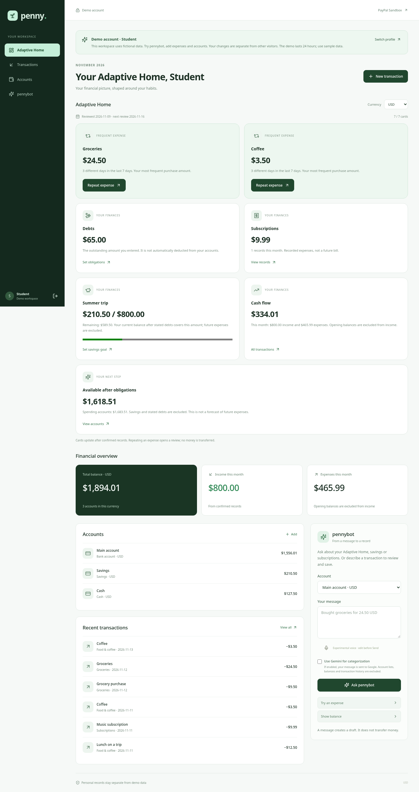
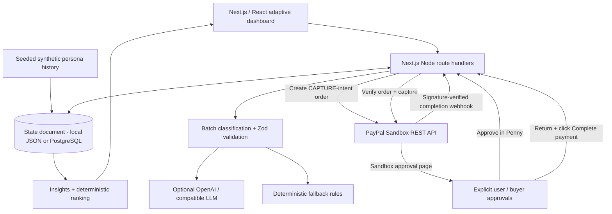

# Penny

A little clarity for your money. **Penny** is an adaptive money workspace built for the PayPal AI Hackathon. **pennybot**, its AI assistant, helps you understand your habits and prepares payment suggestions. Your home rearranges around your spending, and payments only move forward when **you** approve them.

**Adaptive Home is the main page for every personal and demo account.** The site opens `/cabinet`: pick a USD demo profile in one click or use a personal account. Interface text, validation messages, dates and money formatting use English. **All accounts share the Sandbox dashboard design**: one sidebar, topbar, charts, card styles and assistant drawer. Overview, Transactions, Subscriptions, Payments and Agent activity use the signed-in account's data. Accounts are available from the wallet icon. The legacy `/demo` playground remains available with the same shared shell. Existing PayPal return/cancel URLs at `/` remain supported.

Adaptive Home shows **at most seven cards**: up to two frequent-purchase shortcuts, followed by debts, subscriptions, a savings jar, cash flow and a relevant insight. Cards use only the current user's non-voided records in the selected currency. An empty account shows onboarding. Debt totals and savings targets require review and confirmation. Savings come from savings-account balances; subscription totals describe recorded expenses, not future bills.

A shortcut requires purchases on three distinct days in the latest seven calendar days. It uses the most frequent amount, with the latest-charge tie break, and 28-day history for frequency ties. Personal shortcuts keep each account and currency separate. Weekly preferences persist and refresh on the first visit after Monday in the user's time zone; the Sandbox playground uses UTC. Confirmed entries and new habits update immediately. No worker is needed. Personal history uses the current calendar date; the playground's synthetic history stays anchored to its data snapshot.

In your workspace, **Repeat expense** opens a reviewed ledger entry that saves only after confirmation. USD shortcuts also offer **Pay $…**, opening the integrated PayPal Sandbox review. The Payments section can prepare custom USD test orders up to $5,000. Only explicit approval creates an order. The server validates shortcut amounts and uses a stable request UUID to prevent duplicate creation on retries. A habitual shortcut reuses its order for the same user and calendar day, even after reopening the review; completed shortcuts show “Paid today”. PayPal approval and explicit completion on return remain required. These are test payments to Penny's configured Sandbox merchant, not payments to the named shop. Planning records never transfer money. Sandbox captures are kept in their own payment history and do not subtract test funds from a personal ledger balance.



[Mobile preview](docs/screenshots/personal-adaptive-mobile.png)

**The public `/demo` playground uses synthetic spending history and real PayPal Sandbox Orders integration.** The main `/cabinet` workspace records your own income and expenses after sign-in. Neither workspace reads your personal bank or PayPal history. PayPal's Transaction Search API is merchant-side; we do not represent it as a consumer banking feed. Sandbox payments transfer test funds to the configured demo merchant, not the named grocery shop or subscription provider.

## Visual checkout accessibility

**Checkout assist** is available in every signed-in personal/demo workspace. Press **Start listening** to capture a cashier's spoken total as live text. Interim captions never become an amount. A final English phrase such as **“twenty-four dollars and fifty cents”** displays **$24.50 USD** in large, high-contrast text. Numeric totals and English number words are supported; unclear or multiple amounts require correction. You can edit the caption, type an amount, change currency and check it against the bill or cashier's display.

The **“I checked the amount and currency”** checkbox is required and resets after any edit. **Review expense** opens the existing matching-currency account form; it still needs the normal confirmation to save. **Review Sandbox payment** supports USD up to $5,000 and opens the existing PayPal review; it does not create an order. PayPal approval and explicit completion remain required. The tool cannot identify or pay a real cashier or merchant.

Microphone access is manual by default. Enable **Auto listening when I open Penny** once to remember the preference for this account on this device. On a later opening of the signed-in workspace, Penny opens Checkout assist and attempts to start continuous recognition while the page is visible. Nearby speech continues after individual phrases. Recognition cannot identify which speaker is the cashier; competing totals must be corrected rather than guessed.

Use **Pause to review amount** before checking a captured total. **Stop listening** pauses the current visit; closing the panel also prevents it reopening during that visit. The saved setting can be disabled for future openings. Hidden tabs and closed panels release the microphone. An unpaused automatic session resumes on return to the visible page. Payment-return confirmation dialogs take precedence over auto-opening. Permission failures stop retries and leave a manual Start button; repeated rapid browser disconnects also stop instead of looping.

Manual recognition keeps its 30-second limit. Automatic recognition reconnects after normal browser session endings with a short delay and bounded rapid retries. Captions keep at most six result segments; overly long captions are rejected instead of extracting a clipped amount. No recording or transcript is persisted by Penny or sent to Gemini; the device preference stores only a per-account boolean. Your browser may use an external speech service and may require microphone permission or another tap before automatic startup. Speech recognition has [limited browser availability](https://developer.mozilla.org/en-US/docs/Web/API/SpeechRecognition); typed-caption/manual-amount input remains available. The first version recognizes English speech; check the displayed amount against the bill or cashier's display before continuing.

## Personal finance workspace

Open **[Personal workspace / judge access](https://penny-g1zu.onrender.com/cabinet)**, or select its lock icon in the demo header. **Judges can click Student, Family or Freelancer to enter immediately, without registration, email or a password.** Each profile has three USD accounts, sample income, expenses and a seven-card Adaptive Home. Try pennybot, repeat a frequent expense, configure a budget/savings goal and explore the journal. Subscriptions show recorded charges and optional review flags; flags never cancel merchant billing. Agent activity shows real workspace actions and record history. The cabinet labels these records as fictional. Each visitor gets an independent server-side copy, so one judge's edits cannot change another's demo or a registered user's records. The temporary session lasts up to 24 hours; expired demo data is pruned on a subsequent session/demo creation. “Switch profile” signs out and returns to profile selection. Demo users cannot set a password or log in through the personal-email form.

For your own data, use the sign-in/registration form below the demo profiles. Register with your name, email and a password of at least 12 characters. A new personal account starts empty: create bank, cash or savings accounts, enter their opening balances, then record your actual income and expenses. Accounts support **KZT, USD and EUR**; balances and monthly totals remain separate for each currency, with no inferred exchange rate. Your browser time zone determines today's date and the current month.

Select an account and tell **pennybot**: **“Bought groceries for 24.50 USD”**. It prepares a review showing the amount, currency, account, date and category. **Only “Confirm and save” saves the entry.** You can edit the proposal first. Repeated confirmations of the same draft create one entry; drafts expire after 15 minutes. Manual forms use the same review. The journal supports search, filtering and sorting through AG Grid. Cancelling a record preserves its history and removes it from balances; it never refunds or transfers money. Repeated personal expenses can appear as shortcuts to another reviewed ledger entry.

This is manual financial accounting: recording a purchase is separate from the integrated PayPal Sandbox test checkout. There is no bank synchronization or live-money payment in the personal cabinet. CSV import and receipt recognition are planned for a later phase.

Personal pennybot answers English balance, savings, subscription, cash-flow and Adaptive Home questions using the same server-computed cards. It also recognizes supported English/Russian amount patterns without an AI service. Shared voice dictation fills an editable message and never sends it automatically. Gemini categorization is **off by default**. If you explicitly enable it, only the entered message is sent to the configured AI provider; account lists, balances and transaction history are excluded. Its validated category cannot change the amount, currency, account or date. Ambiguous amounts and currency mismatches require correction.

Passwords use salted **scrypt (N=32768, r=8, p=3)**. Seven-day opaque sessions use HttpOnly, SameSite cookies, with Secure and a `__Host-` name on HTTPS; only token hashes are stored. Logout revokes the current session; changing your password revokes other sessions and rotates the current one. Private APIs check ownership on the server, reject cross-origin mutations, limit authentication attempts and disable response caching. Private data is excluded from public persona APIs and stored separately: PostgreSQL table `penny_private_state`, or a mode-0600 `private-ledger.json` in local development. The same `DATABASE_URL` and verified TLS pool are used; no additional environment secret is required. This first version stores the private document in one locked JSONB row; it is intended for a small deployment rather than high-volume use.

Email verification and email-based password recovery are **not implemented yet**; save your password. Authentication and ownership checks have automated coverage, but this is not an independently audited banking service.

## Hackathon integrations and judge access

- **Hosted demo:** https://penny-g1zu.onrender.com
- **One-click judge accounts:** https://penny-g1zu.onrender.com/cabinet — choose **Student**, **Family** or **Freelancer**; no credentials required.
- **Public source:** https://github.com/architron-kak/penny · **License:** [MIT](LICENSE).
- **PayPal Sandbox Orders API v2:** creates checkout orders and captures explicitly approved payments. Server-side **PayPal OAuth 2.0** obtains the API access token. Each payment requires review in Penny, approval in PayPal Sandbox, and explicit completion after returning to Penny.
- **Google Gemini 3.5 Flash Lite:** the hosted AI model, accessed through Google's OpenAI-compatible endpoint. It classifies transaction descriptions, explains Adaptive Home cards, and selects relevant server-computed facts for pennybot's answers. Zod validates model output; deterministic rules handle unavailable or invalid responses. Financial calculations and payment execution remain server-controlled.
- **Render (additional sponsor):** hosts the Next.js application as a Node web service with HTTPS.
- **AG Grid Community (additional sponsor):** powers the interactive Transactions and Subscriptions tables, including sorting, filtering, resizable columns, custom cell renderers and row action buttons. Penny uses AG Grid Community; AG Studio and Studio Agent Framework are not integrated.
- **Neon PostgreSQL:** stores the demo state, planning records and Sandbox order history across application restarts, plus a separate private-account ledger document.
- **Browser Web Speech API:** optional dictation fills an editable chat field in supported browsers. The user reviews and sends it; dictation never executes a payment.
- **Other technologies:** Next.js, React, TypeScript, Tailwind CSS, Framer Motion, AG Grid Community and Zod.

The supplied `.env.example` selects Gemini. To configure AI locally, put your Gemini key in the ignored `.env.local` file:

```dotenv
LLM_PROVIDER=compatible
LLM_BASE_URL=https://generativelanguage.googleapis.com/v1beta/openai
LLM_MODEL=gemini-3.5-flash-lite
LLM_API_KEY=YOUR_GEMINI_API_KEY
```

Open **PayPal Sandbox** from the workspace, or visit [the playground](https://penny-g1zu.onrender.com/demo). It requires no application login. Select **Student**, **Family** or **Freelancer** in the persona menu. These are shared synthetic workspaces; use sample data. Explore Adaptive Home, Transactions, Subscriptions and pennybot chat. For example, ask **"Summarize my spending this month"**. Open the savings card to preview a goal, or explore debt and income-delay forecasts. Planning records save only after explicit confirmation.

To test checkout, open a frequent-purchase **Pay $…** shortcut or a prepared suggestion in **Payments**, review the amount, and select **Approve & continue to PayPal**. A **PayPal Sandbox personal/buyer account** is required only to complete this optional checkout. Use a test buyer created in the PayPal Developer Dashboard, approve the test payment, return to Penny and click **Complete Sandbox payment**. Check Payments, Transactions and Agent activity for the result. No live PayPal account or real money is needed. Developer API keys and merchant secrets are already configured server-side and must not be shared with judges. If the free hosted service is waking from inactivity, wait for it to load and retry.

## Run locally

Requires **Node.js 22+** and npm. No LLM key is required. The app also starts without PayPal credentials; payment actions are clearly disabled until they are configured.

```bash
npm install
cp .env.example .env.local
# Set PAYPAL_CLIENT_ID and PAYPAL_CLIENT_SECRET in .env.local to enable payments.
npm run seed
npm run dev
```

Open **http://localhost:3000**. `APP_URL` must match the browser origin exactly (scheme, host, and port). Restart the server after changing environment variables. To use a different port, update `APP_URL` too.

`npm run seed` creates three deterministic datasets (roughly 200 transactions per persona over six months), writes reviewable files to `data/seed/`, and initializes the ignored JSON database in `data/runtime/`. If the database does not exist, the first API request seeds it automatically. Dates default to today; all demo insights are anchored to the seed date so that the demo remains reproducible.

```bash
npm run seed -- --date=2026-10-25
# Refuses to overwrite existing payment records unless you explicitly reset:
npm run seed -- --reset
```

Resetting erases local demo state, including order history; it does not reverse Sandbox captures. Do not reset data while the server is processing payments.

## Get PayPal Sandbox credentials

1. Sign into the [PayPal Developer Dashboard](https://developer.paypal.com/dashboard/).
2. Under **Apps & Credentials**, select **Sandbox** and create a REST app linked to a Sandbox **business** account.
3. Copy that app's client ID and secret to `PAYPAL_CLIENT_ID` and `PAYPAL_CLIENT_SECRET` in `.env.local`.
4. Under **Testing Tools → Sandbox Accounts**, create or open a separate **personal** buyer account. Use its test email/password on the Sandbox checkout page. Do not log in with the merchant account.
5. Restart Penny. The payments view will show **Sandbox connected**.

The server's PayPal endpoint is fixed to `https://api-m.sandbox.paypal.com`. There is no live-mode switch. Credentials are used only on the server, and no `.env` file should be committed.

## Demo walkthrough

1. Start with **Student** and click **Headphones · up to $100.00**. The card opens its full explanation in pennybot: $200 available, ten $5 lunches, $30 essential bills, and a $20 reserve. The local fictional catalog offers only models within the computed limit. Change the lunch schedule to **Weekdays only** to recalculate actual UTC dates; previewing assumptions does not save them.
2. Say **“I owe Ali $40 by Friday”**, review the proposed record, and click **Confirm and save debt**. The headphone card now shows **$60**. Say **“I already returned Ali $40 in cash”** and explicitly confirm the cash record. Balance becomes **$160**, the debt is settled, and the headphone limit stays **$60**. The same figure is returned by the home and chat APIs.
3. Open **Show my debts** to add multiple debts and installments, record partial payments/receipts, inspect history, or try another schedule. Every change is previewed on the server and requires confirmation to save. Incoming debts are excluded until actually received.
4. Switch to **Family**. Click the overdue **$35 refund** card to inspect the original purchase and explicitly confirm **money arrived**. Its card disappears and available balance is credited once. In **Transactions**, use **Track refund** on a purchase to enter an amount and promised date.
5. Click **Home Cinema · $8 → $11/mo**. pennybot shows the two dated charges and the **$36 annual difference**, with no claim about why it rose. **I changed my plan** acknowledges the alert; it does not cancel or change a subscription.
6. Switch to **Freelancer** and click the income-delay card. Compare daily balances at the original date and seven days later, including the first shortage on rent. Try **0** or another number of days. The original income date remains unchanged; the explicit save button only saves the watch scenario.
7. In chat, optionally use the experimental microphone. Recognition **only fills the editable text box**. Correct the amount/recipient, then press Send. **“Pay groceries $20”** reports that there is no matching prepared suggestion; **“Pay groceries $45”** for Student opens a review action for its existing Sandbox suggestion. No utterance or chat request creates/captures an order. **“I already returned Ali $40 in cash”** is a separate local debt-recording proposal.
8. Payments retain the original steps: click **Approve & continue to PayPal**, confirm with a Sandbox buyer, return, then explicitly click **Complete Sandbox payment**. Successful captures appear in Payments/Transactions and reduce the local available balance once. They go to the configured Sandbox merchant, never a friend or named retailer.
9. Inspect **Agent activity**, AG Grid filters, and **Motion / Calm**. Existing animations and reduced-motion behavior are preserved.

For a fresh independent demo without erasing existing orders, run with an isolated directory: `DATA_DIR=./data/runtime/planning-demo npm run dev`. Initial data is created automatically. All planning dates use the displayed **seed-date UTC snapshot**, rather than silently advancing the demo clock. Installments on the income date are funded after that day's expected income; dates before it are reserved in the purchase budget.

If you cancel at PayPal, no capture is requested. You may resume the prepared order from Payments. A new order is not created on every retry. Approve/capture requests use stable PayPal idempotency IDs; capture checks the remote order's approved status, amount, currency, and suggestion reference. The approving browser's HttpOnly session must match the capture request. Repeated captures and webhook deliveries do not duplicate local records.

## Architecture



Next.js App Router, TypeScript, Tailwind CSS 4 with custom CSS, Framer Motion, AG Grid Community, Zod, and fetch-based PayPal REST integration. Local JSON storage uses atomic rename plus a filesystem lock. When `DATABASE_URL` is set, the same state document is stored as one PostgreSQL JSONB row. Writes use a single checked-out connection and `SELECT ... FOR UPDATE` inside an explicit transaction, so concurrent financial confirmations are serialized and failures roll back. The small connection pool uses verified TLS for remote databases. OAuth tokens are cached server-side until near expiration. Money is summed in integer cents.

### AI behavior

- `lib/llm.ts`: provider wrapper for OpenAI and OpenAI-compatible Chat Completions endpoints. Requests JSON output; validates every response with Zod. One retry on request/parsing/validation failure, then rules. No API key means no remote LLM request.
- `lib/classify.ts`: batches distinct merchant/description pairs; validates category enums, complete coverage, and unique input IDs. Caches results persistently. Adding a key upgrades rules-based classifications on the next load.
- `lib/insights.ts`: computes all monetary aggregates on the server, unused subscriptions (>45 days), category budgets, previous full-month spend, previous five-month average, and recurring merchants.
- `lib/ranking.ts`: pure, unit-tested scores based on budget pressure, unused subscriptions, payment review, merchant frequency, total amount, and recency. The LLM cannot alter scores or initiate payments.
- Card explanations are short validated strings cached by their inputs. Without a key, templates explain the same ranking.
- Chat asks the model to choose relevant IDs from a closed set of computed facts; the server renders the selected fact templates. The model cannot invent amounts or invoke a payment. Without a key, keyword rules select those facts.

See the official [Chat Completions reference](https://developers.openai.com/api/reference/resources/chat/subresources/completions/methods/create) for the optional API contract and [PayPal Orders v2](https://developer.paypal.com/docs/api/orders/v2/) for order creation/capture.

### Planning and confirmation

`lib/planning.ts` performs the purchase forecast, weekday enumeration, debt allocation, dated cash forecasts, price comparison, and catalog filtering using integer cents. `lib/planning-chat.ts` recognizes the supported English/Russian intents and returns computed facts, draft actions, and clarifying questions; all six main scenarios work without an LLM key. General spending chat continues to use the existing optional structured LLM wrapper.

The home page shows a single conclusion per card. Clicking it sends its topic/entity to chat for the active persona. Detailed assumptions, evidence transactions, models, daily comparisons, and editing controls live in pennybot. If a merchant-only transaction does not establish that it was lunch, the forecast asks for confirmation. Missing balance, reserve, lunch cost, or income date also produces a question. The lunch allowance and the explicit non-lunch habit allowance are disjoint; category-budget totals are not subtracted a second time.

Planning mutations use `/api/planning/preview` to simulate a change on a clone, followed by `/api/planning` with `confirmed: true` and a stable request UUID. Repayments reduce both available balance and the corresponding remaining installments. Receiving a debt/refund increases balance only after explicit confirmation. Repeated request IDs and repeated refund-receipt confirmations cannot double-apply money. Local records never call PayPal.

Old databases are lazily upgraded with an optional versioned `planning` store and stable synthetic demo-example IDs. Existing transactions are preserved, example records are appended once, and Sandbox order/capture history is retained. The original local `pennybot.json` path and session cookie stay unchanged; an optional one-time PostgreSQL import preserves the same state document. A new seed has a few additional synthetic transactions/subscriptions beyond the original datasets.

Price alerts require matching USD merchant charges and equal monthly/annual periods, with plausible billing intervals. They show the increase and its annualized difference only; acknowledging a plan change does not alter billing. Expected refunds are bounded by the original purchase amount across all tracked refunds.

Voice support uses the browser's experimental [SpeechRecognition API](https://developer.mozilla.org/en-US/docs/Web/API/SpeechRecognition), which is unavailable in some browsers and may use the browser provider's online speech service. Permission/recognition failures leave text input available. Friend transfers, arbitrary new PayPal recipients/amounts, and non-USD payments are unsupported. The microphone never submits the transcript or bypasses the existing payment approval flow.

### Environment variables

| Variable                  | Default                                               | Purpose                                                                                             |
| ------------------------- | ----------------------------------------------------- | --------------------------------------------------------------------------------------------------- |
| `APP_URL`                 | local: `http://localhost:3000`; Render: automatic URL | Optional explicit origin for custom domains; used for return URLs, origin checks and HTTPS cookies. |
| `RENDER_EXTERNAL_URL`     | Provided automatically by Render                      | Default public HTTPS origin on Render when `APP_URL` is unset.                                      |
| `DATA_DIR`                | `./data/runtime`                                      | Local JSON storage directory, used only when `DATABASE_URL` is empty.                               |
| `DATABASE_URL`            | empty                                                 | Server-only PostgreSQL URL; required on Render Free. Keep it out of Git and browser code.           |
| `REQUIRE_REMOTE_DATABASE` | `false` locally; `true` in Render Blueprint           | Refuse ephemeral JSON fallback if hosted PostgreSQL is missing.                                     |
| `PAYPAL_CLIENT_ID`        | empty                                                 | Sandbox REST app client ID; required for payments.                                                  |
| `PAYPAL_CLIENT_SECRET`    | empty                                                 | Sandbox secret; server only.                                                                        |
| `PAYPAL_WEBHOOK_ID`       | empty                                                 | ID of the webhook registered on the same Sandbox app.                                               |
| `LLM_PROVIDER`            | `openai`                                              | `openai` or `compatible`; unrecognized providers fall back to rules.                                |
| `LLM_API_KEY`             | empty                                                 | Optional; missing/failed key activates rules.                                                       |
| `LLM_MODEL`               | `gpt-4.1-mini`                                        | Model identifier supported by your provider.                                                        |
| `LLM_BASE_URL`            | empty                                                 | Required for `compatible`, e.g. an endpoint ending in `/v1`; keep credentials out of URLs.          |
| `PORT`                    | `3000`                                                | Next.js serving port; Render sets this automatically.                                               |

### API

| Method | Route                            | Behavior                                                                                                   |
| ------ | -------------------------------- | ---------------------------------------------------------------------------------------------------------- |
| GET    | `/api/home?user=student`         | Persona, ranked cards, aggregates, records, capability status; sets demo session cookie.                   |
| GET    | `/api/transactions?user=student` | Classified transaction rows.                                                                               |
| POST   | `/api/suggestions/:id/approve`   | `{ user, approved: true }`; creates Sandbox order and returns approval URL.                                |
| POST   | `/api/suggestions/:id/dismiss`   | `{ user }`; records dismissal of an unapproved suggestion.                                                 |
| POST   | `/api/paypal/capture`            | `{ orderId, userApproved: true }`; validates and captures an approved order owned by this browser session. |
| POST   | `/api/paypal/webhook`            | Signature-verified capture completion; never initiates capture.                                            |
| POST   | `/api/subscriptions/:id`         | `{ user, action: "suggest-cancel" \| "undo" }`; local suggestion only.                                     |
| POST   | `/api/chat`                      | `{ user, message }`; answer based on server-computed facts.                                                |
| GET    | `/api/planning?user=student`     | Current profile, purchase limit, debts/refunds, and forecasts.                                             |
| POST   | `/api/planning/preview`          | `{ user, command }`; compute a draft on a clone without saving.                                            |
| POST   | `/api/planning`                  | `{ user, command, confirmed: true, requestId }`; validate and persist a local planning action once.        |
| GET    | `/api/health`                    | Basic health check without creating or modifying payment records.                                          |

Mutation requests require an `Origin` header matching the configured application origin. Demo personas are public sample workspaces; the personal cabinet uses separate authenticated APIs:

| Method | Route | Behavior |
| ------ | ----- | -------- |
| POST | `/api/account/demo` | `{ profile: "student" \| "family" \| "freelancer" }`; issue an isolated, seeded, temporary judge session. |
| POST | `/api/account/register`, `/api/account/login` | Create an account or sign in; issue a session cookie. |
| GET | `/api/account/me` | Current user, without password or session hashes. |
| POST | `/api/account/logout`, `/api/account/password` | Revoke the session or change the password. |
| GET | `/api/finance/overview` | Only the signed-in user's accounts, entries, totals and Adaptive Home by currency. |
| POST | `/api/finance/home-plan` | Review-confirmed monthly budget, debt total and savings goal for the current user and currency; no account balance changes. |
| POST | `/api/finance/accounts` | Create an owned account with an immutable currency. |
| POST | `/api/finance/drafts`, `/api/finance/pennybot` | Prepare a manual or text-based entry; do not change the ledger. |
| POST | `/api/finance/drafts/:id/confirm` | `{ confirmed: true }`; save the owned draft once. |
| POST | `/api/finance/entries/:id/void` | `{ confirmed: true }`; cancel an owned record, preserving history. |
| POST | `/api/finance/subscriptions/review` | Flag an owned subscription for review; never change merchant billing. |
| POST | `/api/finance/payments` | Confirm a USD Sandbox order with a stable `requestId`; validate optional shortcut evidence. |
| POST | `/api/finance/payments/:id/capture` | `{ confirmed: true }`; check owner, remote approval, reference, currency and captured amount before recording completion. |

## Webhooks

1. Host on HTTPS or expose your local server using an HTTPS tunnel. Set `APP_URL` to that public origin.
2. In your Sandbox REST app, add webhook URL `https://YOUR-HOST/api/paypal/webhook` and subscribe to `PAYMENT.CAPTURE.COMPLETED`.
3. Save its ID as `PAYPAL_WEBHOOK_ID`, restart/redeploy, then complete a normal payment through this app.
4. Penny sends the original event and signature headers to PayPal's `/v1/notifications/verify-webhook-signature`. Only `SUCCESS` is accepted. Matching completed capture events update existing approved orders, deduplicate by event/capture ID, and appear in the UI on its next 30-second poll.
5. Use PayPal's [webhook simulator](https://developer.paypal.com/dashboard/webhooksSimulator) to exercise delivery to your endpoint. Simulated events may not pass REST verification against a real registered webhook ID and do not refer to local Penny orders. A rejected simulated event or a verified event with no matching order never marks a payment paid. Do not disable verification to accommodate the simulator; validate the full completion flow with a real Sandbox buyer payment and use the dashboard's event resend feature to test replay handling.

The webhook does not capture on `CHECKOUT.ORDER.APPROVED`; only a user action in the app invokes capture. See [PayPal signature verification](https://developer.paypal.com/docs/api/webhooks/v1/#verify-webhook-signature_post).

## Checks

### Animation and performance

- Scroll reveals and chart growth run once per mounted block using a shared `IntersectionObserver` and the browser's Web Animations API. They animate `transform`/`opacity`; content stays visible if animation support is unavailable. Observed elements are released after entering view and animations are cancelled on unmount or when the tab is hidden.
- `WorkspaceFrame`, brand/navigation, sidebar assistant and chart bars are shared between account types. Personal cards are memoized; no polling is added to the private workspace. Shared chart/reveal effects respect Calm mode and system reduced motion.
- Card reordering uses Motion's position-only layout animation with stable keys. Layout measurements depend on the persona/card order, so typing in chat and unchanged polling results do not restart the grid animation. Motion's layout feature bundle is loaded asynchronously through `LazyMotion`.
- The active navigation indicator moves between views. A thin native CSS reading-progress line is shown in browsers supporting scroll timelines; other browsers omit it. Pointer hover effects are limited to devices with a fine pointer.
- Use the **Motion / Calm** button in the header to reduce animations. The preference persists locally, and the operating system's reduced-motion setting always takes precedence. This applies to reveals, charts, card layout, chat, notifications, CSS transitions, smooth chat scrolling, and AG Grid rows.
- Polling pauses in hidden tabs and refreshes on return. Superseded home requests are aborted, unchanged snapshots are reused, and chart/card leaves are memoized. AG Grid remains loaded only when its tab is opened.
- Existing local `pennybot.json` and browser-session cookies keep their original internal names to preserve saved demo data after renaming the project to Penny.

See the implementation guidance for [Motion lazy loading](https://motion.dev/docs/react-lazy-motion) and [layout animation](https://motion.dev/docs/react-layout-animations).

### Commands

```bash
npm test
npm run lint
npm run typecheck
npm run build
npm start
# Optional real database integration tests, against an isolated local database only:
PG_TEST_URL=postgresql://YOUR_USER@127.0.0.1:55439/postgres npm test
```

Tests additionally cover the $100 → $60 → $60 purchase/debt invariant, actual weekdays, partial repayments, refund receipt idempotency, billing-period comparison, income-delay shortfalls, legacy upgrades, confirmation-only mutations, and voice-style requests that must not create orders. Tests cover monetary aggregation, time boundaries, unused-subscription thresholds, deterministic seed data and ranking, persona differences, schema validation and retry fallback, and payment approval/amount/idempotency invariants. External PayPal and LLM calls in unit tests are mocked; a successful automated test is not a claim that a live Sandbox payment has been verified.

## Free deployment: Render Free + Neon Free

The default `render.yaml` uses a **free Node Web Service**, no paid disk, and an external PostgreSQL database. Render Free loses local file changes when it spins down/restarts, so hosted financial records must not use the JSON fallback. The Blueprint enforces this with `REQUIRE_REMOTE_DATABASE=true`; missing `DATABASE_URL` makes the health endpoint return 503.

1. Create a **Free** Neon project/database. Choose a region near the Render service. Copy its PostgreSQL connection string, preferably the pooled URL, into Render's secret `DATABASE_URL` setting. Do not commit it or place it in `.env.example`.
2. Connect Render to the public GitHub repository `architron-kak/penny`. Create a **Blueprint** from `render.yaml` on `main` and confirm the service plan is **Free**. The Blueprint does not create a paid database or disk.
3. Provide `DATABASE_URL`, `PAYPAL_CLIENT_ID`, and `PAYPAL_CLIENT_SECRET` during setup. If testing without payments, empty PayPal credentials leave review/analysis available and payment approval disabled. `LLM_API_KEY` remains optional.
4. Keep `APP_URL` unset for Render's default domain. The app uses `RENDER_EXTERNAL_URL` for origin checks, HTTPS cookies, and PayPal return/cancel URLs. For a custom domain, set `APP_URL` explicitly. Do not copy the localhost `APP_URL` from `.env.local` into Render.
5. Build: `npm ci --include=dev && npm run build`. Start: `npm start`; Next.js uses Render's assigned `PORT`. Health: `/api/health` reports storage configuration without continuously waking the remote database.
6. Open the home page. Its first database access creates `penny_state` and initializes the seeded document if absent. Future restarts/redeploys read the existing PostgreSQL document. Do not run `npm run seed -- --reset` on your hosted database.
7. After deployment, add `PAYPAL_WEBHOOK_ID` only after registering the deployed HTTPS webhook in your Sandbox app. `LLM_API_KEY` can also be added later. Auto-deploys are disabled with `autoDeployTrigger: "off"`.

The app creates the `penny_state` table, so the database role must be allowed to create tables in its selected schema. Remote connections use certificate-verified TLS. Only loopback connections to local development/test PostgreSQL may use plain TCP. This single-document store is intended for a small shared hackathon demo, not high-throughput multi-tenant banking.

### Preserve existing local history

If you want to bring existing local JSON history into PostgreSQL, import it **before opening the hosted home page**, into an empty dedicated destination:

```bash
# Set DATABASE_URL privately in .env.local or your shell first.
npm run db:import
# Or explicitly choose a source file:
npm run db:import -- --from=./data/runtime/pennybot.json
```

The importer validates the state document, preserves order/capture history, does not modify the source JSON, and refuses to overwrite a database that already has a state row. With `DATABASE_URL` empty, normal local development continues to use JSON exactly as before.

### Free-tier limitations

Both services must remain on their **Free** plans and within their included quotas. This is deployment configuration, not a claim that accounts have been created or the app is already hosted. Render Free sleeps after inactivity, so the first request can be slow; its PostgreSQL free trial is time-limited and is not used by this configuration. Neon Free has storage/compute limits and may suspend compute when idle. Review [Render Free limitations](https://render.com/docs/free) and [Neon Free limits](https://neon.com/pricing) before launching. No automatic plan upgrade is configured by this repository.

After deployment, check `/api/health`, try a confirmed planning action, restart the web service, and verify the record remains. Complete one Sandbox buyer payment before claiming the hosted payment flow is verified.

## Known limitations

- The public demo's spending history, planning balances/incomes/obligations, headphone models/prices, merchants, subscription usage and budgets are synthetic and denominated in USD. Sandbox captures are labeled separately. The private cabinet uses your own manually entered KZT/USD/EUR records.
- The three public personas share demonstration state without login; use sample data there. Payment capture is tied to the approving browser session. Personal records require a separate account at `/cabinet`; they are not incorporated into public demo forecasts or Sandbox payments. Email recovery, CSV import, receipt OCR and bank synchronization remain future work.
- A cancellation suggestion does not cancel a real subscription. Real subscription plan creation (P2) is deliberately outside this finished flow.
- The current demo month may be partial; the comparison explicitly uses the previous full month, not a like-for-like projection. Future captures beyond the seed date remain in the table/history but do not alter the historical snapshot aggregates; reseeding can refresh the snapshot with the reset caveat above.
- Cash forecasts include only the single configured next income and explicit obligations plus estimated habits; they are scenarios, not a bank balance feed or a guarantee. The other-habits allowance excludes lunch and must be maintained separately from lunch. The planning clock is anchored to the seed-date snapshot.
- Natural-language support covers the demonstrated English/Russian patterns; use the in-chat forms to specify exact amounts, dates, and installment schedules when a phrase is ambiguous.
- In rules mode, explanations and chat use templates. Optional model calls can add latency; failure falls back after one retry. Explanations are schema-checked, not guaranteed free of all semantic errors.
- Webhook signature verification requires registered Sandbox credentials, a webhook ID, and a reachable HTTPS endpoint. No unverified webhook fallback exists.
- No external logos or copyrighted image assets are used; icons come from Lucide (ISC). The sprout mark and UI are code-based.

MIT licensed. See [LICENSE](LICENSE).
